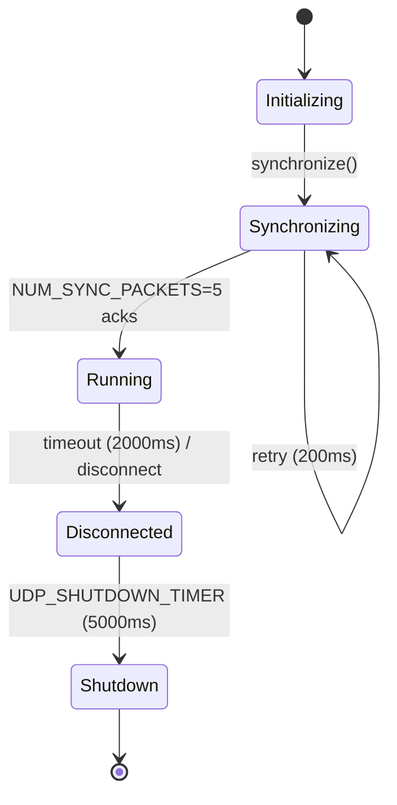

<!-- SYNC: This source doc syncs to wiki/Formal-Specification.md. -->

<p align="center">
  
</p>

# Fortress Rollback Formal Specification

**Version:** 1.11
**Date:** November 27, 2026
**Status:** Complete

This document provides a formal specification of Fortress Rollback's core components, invariants, and correctness properties. It serves as the foundation for formal verification using TLA+, Z3, and Kani.

## Changelog

- **v1.11 (2026-11-27):** Extracted the coordinated-drop state model and pure
  attempt transitions into `src/sessions/coordinated_drop.rs` and added three
  Kani proofs for failover authority selection and the canonical backfill
  chunk plan; the module owns the bounded state but no new policy.
- **v1.10 (2026-11-27):** Added the Z3 proof-strength classification to the
  `[z3_proof_strength]` table in `docs/specs/verification-manifest.toml` and
  the coverage check in `model-impact.py check`: all 66 `z3_*` tests are
  classified, no Z3 test is code-linked, and the frame/queue rows now say
  model-only instead of implying a production proof.
- **v1.9 (2026-11-27):** Extracted `ReadyTranscripts`
  (`src/sessions/ready_transcripts.rs`) from `p2p_session` as a
  provisional/locked typestate and added three Kani proofs for the admission
  rule, non-authority provisional reports, and matching-only promotion; the
  SAFE-12a implementation notes now name the kernel and its residual coverage.
- **v1.8 (2026-11-26):** Extracted the coordinated-drop terminal-epoch table
  (`src/sessions/terminal_epoch.rs`) and added five Kani proofs for monotone
  advancement, the production coordinator/generation identity component, the
  caller-independent two-generation bound, bounded fallback adoption, and
  canonical target handles; the epoch paragraph no longer claims preservation
  "without a new model".
- **v1.7 (2026-11-26):** Added SAFE-12a and `CoordinatedReadyDigest.tla` for
  the #529/#530 provisional `Ready` digest gate: only the effective authority or
  independently verified local history locks the cut digest, a pre-lock
  provisional does not count until promoted, and the pre-#530 first-Ready-wins
  rule is an enforced expected-fail.
- **v1.6 (2026-11-26):** Extracted `ChecksumBasisTracker` and added
  `ChecksumBasis.tla` with an enforced `BasisBlind` expected-fail and a
  non-vacuity witness; the five Kani proofs cover the transition and fold
  kernels.
- **v1.5 (2026-11-26):** Retired the stale Z3 desync claims and documented
  SAFE-7a/7b/7c: the basis-token comparison gate, the converged-history token
  property, and the confirmed-history rewrite that clears a latched mismatch.
- **v1.1 (Session 47 - Dec 10, 2025):** FV-GAP-6 updates
  - Added INV-9: Rollback Target Guard
  - Strengthened `load_frame()` precondition: `frame < current_frame` (was ≤)
  - Added `skip_rollback()` operation specification

---

## Table of Contents

1. [Notation](#notation)
2. [Core Types](#core-types)
3. [System Invariants](#system-invariants)
4. [Component Specifications](#component-specifications)
5. [Protocol Specifications](#protocol-specifications)
6. [Safety Properties](#safety-properties)
7. [Liveness Properties](#liveness-properties)
8. [Constants](#constants)

---

## Notation

| Symbol   | Meaning                        |
| -------- | ------------------------------ |
| `∀`      | For all                        |
| `∃`      | There exists                   |
| `∧`      | Logical AND                    |
| `∨`      | Logical OR                     |
| `¬`      | Logical NOT                    |
| `→`      | Implies                        |
| `↔`      | If and only if                 |
| `∈`      | Element of                     |
| `ℕ`      | Natural numbers (0, 1, 2, ...) |
| `ℤ`      | Integers                       |
| `[a, b]` | Closed interval from a to b    |
| `[a, b)` | Half-open interval             |
| `⊥`      | Undefined/null value           |
| `□`      | Always (temporal)              |
| `◇`      | Eventually (temporal)          |
| `○`      | Next state (temporal)          |
| `X'`     | Value of X in next state       |

---

## Core Types

### Frame

A frame represents a discrete time step in the game simulation.

```
Frame = ℤ
NULL_FRAME = -1

VALID_FRAME(f) ↔ f ≥ 0
```

**Operations:**

```
frame_add: Frame × ℤ → Frame
    frame_add(f, n) = f + n

frame_sub: Frame × Frame → ℤ
    frame_sub(f1, f2) = f1 - f2

frame_valid: Frame → Bool
    frame_valid(f) = f ≠ NULL_FRAME ∧ f ≥ 0
```

### PlayerHandle

```
PlayerHandle = ℕ
num_players: ℕ  -- configured at session creation

VALID_PLAYER(h) ↔ h ∈ [0, num_players)
VALID_SPECTATOR(h) ↔ h ≥ num_players
```

### PlayerInput

```
PlayerInput<T> = {
    frame: Frame,
    input: T
}

BLANK_INPUT(f) = PlayerInput { frame: f, input: T::default() }
```

### InputStatus

```
InputStatus = Confirmed | Predicted | Disconnected
```

### ConnectionStatus

```
ConnectionStatus = {
    disconnected: Bool,
    last_frame: Frame,
    epoch: ℕ            -- u16 monotonic per-slot generation, bumped on each
                       -- connected<->disconnected transition; rides the
                       -- connect-status gossip on every Input packet
}
```

---

## System Invariants

These invariants **MUST** hold at all times during system operation.

### INV-1: Frame Monotonicity

```
□(current_frame' ≥ current_frame ∨ IN_ROLLBACK)
```

The current frame never decreases except during explicit rollback.

### INV-2: Rollback Boundedness

```
□(rollback_depth ≤ max_prediction)
    where rollback_depth = current_frame - frame_to_load
```

### INV-3: Input Consistency (Immutability)

```
□(∀f ∈ Frame, p ∈ PlayerHandle:
    confirmed(f, p) → □(input(f, p) = input(f, p)))
```

Once confirmed, inputs never change.

### INV-4: Queue Length Bounds

```
□(∀q ∈ InputQueue: 0 ≤ q.length ≤ INPUT_QUEUE_LENGTH)
    where INPUT_QUEUE_LENGTH = 128
```

### INV-5: Queue Index Validity

```
□(∀q ∈ InputQueue:
    q.head ∈ [0, INPUT_QUEUE_LENGTH) ∧
    q.tail ∈ [0, INPUT_QUEUE_LENGTH))
```

### INV-6: State Availability

```
□(∀f ∈ [current_frame - max_prediction, current_frame]:
    state_exists(f) ∨ f < first_saved_frame)
```

### INV-7: Confirmed Frame Consistency

```
□(last_confirmed_frame ≤ current_frame)
```

### INV-8: Saved Frame Consistency

```
□(last_saved_frame ≤ current_frame)
```

### INV-9: Rollback Target Guard (Added Session 47 - FV-GAP-6)

```
□(load_frame_called(f) → f < current_frame)
```

The `load_frame()` operation is only called when the target frame is strictly
less than the current frame. When `first_incorrect_frame >= current_frame`,
`skip_rollback()` is called instead.

This invariant captures the guard in `adjust_gamestate()`:

```rust
if load_target >= current_frame {
    // skip_rollback path
    return Ok(());
}
// Only reach load_frame if load_target < current_frame
```

### INV-9a: Message Causality

```
□(∀m1, m2 ∈ Message:
    sent(m1) < sent(m2) ∧ same_peer(m1, m2) →
    received(m1) < received(m2) ∨ ¬received(m2))
```

### INV-10: Determinism

```
□(∀s1, s2 ∈ State, inputs ∈ InputSequence:
    s1 = s2 → advance(s1, inputs) = advance(s2, inputs))
```

### INV-11: No Panics

```
□(∀api_call: result ∈ {Ok(_), Err(FortressError)})
```

All public APIs return Result, never panic.

---

## Component Specifications

### InputQueue&lt;T&gt;

**State:**

```
InputQueue<T> = {
    inputs: Array<PlayerInput<T>, 128>,
    head: ℕ,                    -- next write position
    tail: ℕ,                    -- oldest valid input
    length: ℕ,                  -- valid entries count
    frame_delay: ℕ,
    first_incorrect_frame: Frame,
    last_added_frame: Frame,
    last_requested_frame: Frame,
    prediction: PlayerInput<T>
}
```

**Initial State:**

```
INIT = {
    inputs: [BLANK_INPUT(NULL_FRAME); 128],
    head: 0, tail: 0, length: 0,
    frame_delay: configured,
    first_incorrect_frame: NULL_FRAME,
    last_added_frame: NULL_FRAME,
    last_requested_frame: NULL_FRAME,
    prediction: BLANK_INPUT(NULL_FRAME)
}
```

**Operations:**

#### add_input(input) → Frame

```
PRE:
    input.frame = last_added_frame + 1 ∨ last_added_frame = NULL_FRAME

POST:
    length' = min(length + 1, 128)
    head' = (head + 1) mod 128
    last_added_frame' = input.frame
    inputs[head]' = input

RETURNS:
    input.frame (success) | NULL_FRAME (rejected)
```

#### get_input(frame) → (PlayerInput, InputStatus)

```
PRE: frame ≥ 0

POST:
    frame ≤ last_added_frame →
        RETURNS (inputs[frame mod 128], Confirmed)
    frame > last_added_frame →
        RETURNS (prediction, Predicted)
```

#### confirmed_input(frame) → Result&lt;PlayerInput, Error&gt;

```
PRE:
    frame ≤ last_added_frame
    frame ≥ last_added_frame - length + 1

POST:
    RETURNS Ok(inputs[frame mod 128])

ERROR:
    frame mismatch (no confirmed input at slot) → NoConfirmedInput (FortressError::InvalidRequestStructured)
```

#### reset_prediction()

```
POST: first_incorrect_frame' = NULL_FRAME
```

### SyncLayer&lt;T&gt;

**State:**

```
SyncLayer<T> = {
    num_players: ℕ,
    input_queues: Array<InputQueue<T>, num_players>,
    saved_states: SavedStates<T>,
    current_frame: Frame,
    last_confirmed_frame: Frame,
    last_saved_frame: Frame,
    max_prediction: ℕ,
    sparse_saving: Bool
}
```

**Operations:**

#### add_local_input(handle, input) → Result&lt;Frame, Error&gt;

```
PRE:
    VALID_PLAYER(handle)
    input_queues[handle].last_added_frame < current_frame + frame_delay

POST:
    input added to input_queues[handle]
    RETURNS Ok(frame)
```

#### add_remote_input(handle, input) → Frame

```
PRE:
    VALID_PLAYER(handle)

POST:
    -- Check prediction correctness
    old_prediction ≠ input.input ∧ first_incorrect_frame = NULL_FRAME →
        first_incorrect_frame' = input.frame
    RETURNS input_queues[handle].add_input(input)
```

#### synchronized_inputs(connect_status) → Option&lt;Vec&lt;(Input, InputStatus)&gt;&gt;

```
POST:
    result.length = num_players
    ∀p ∈ [0, num_players):
        connect_status[p].disconnected →
            result[p] = (Input::default(), Disconnected)
        ¬connect_status[p].disconnected →
            result[p] = input_queues[p].get_input(current_frame)
```

#### advance_frame()

```
POST: current_frame' = current_frame + 1
```

#### save_current_state() → SaveRequest

```
POST:
    last_saved_frame' = current_frame
    RETURNS SaveGameState { frame: current_frame, cell }
```

#### load_frame(frame) → Result&lt;LoadRequest, Error&gt;

**Updated (Session 47 - FV-GAP-6):** The precondition was strengthened to require
`frame < current_frame` (strictly less than). The case where `frame >= current_frame`
is handled by `skip_rollback()` instead.

```
PRE:
    frame ≠ NULL_FRAME
    frame < current_frame           -- STRENGTHENED: was ≤, now strictly <
    frame ≥ current_frame - max_prediction

POST:
    current_frame' = frame
    RETURNS Ok(LoadGameState { frame, cell })

ERROR:
    frame = NULL_FRAME → InvalidFrameStructured(NullFrame)        -- "cannot load NULL_FRAME"
    frame >= current_frame → InvalidFrameStructured(NotInPast)    -- "must load frame in the past (current: …)"
```

#### skip_rollback()

**Added (Session 47 - FV-GAP-6):** This operation handles the case where
`first_incorrect_frame >= current_frame`, which can occur at frame 0 when a
misprediction is detected before any frame has advanced.

```
PRE:
    first_incorrect_frame ≠ NULL_FRAME
    first_incorrect_frame >= current_frame   -- This is the trigger condition

POST:
    first_incorrect_frame' = NULL_FRAME      -- Reset prediction tracking
    -- No state change (no load_frame call)

COMMENT:
    This operation is called instead of load_frame() when the rollback
    target would be at or after the current frame. The typical scenario
    is misprediction detected at frame 0:
        first_incorrect_frame = 0, current_frame = 0

    Production code (p2p_session.rs, adjust_gamestate):
        let load_target = frame_to_load.max(window_floor); // clamp UP to prediction-window floor
        if load_target >= current_frame {
            self.sync_layer.reset_prediction();
            return Ok(());  // Skip rollback
        }
```

---

## Protocol Specifications

### UdpProtocol State Machine

```
States = { Initializing, Synchronizing, Running, Disconnected, Shutdown }
Initial = Initializing

Transitions:
    Initializing  →[synchronize()]→     Synchronizing
    Synchronizing →[sync_complete]→     Running
    Synchronizing →[timeout]→           Synchronizing  (retry)
    Running       →[timeout]→           Disconnected
    Running       →[disconnect_req]→    Disconnected
    Disconnected  →[shutdown_timer]→    Shutdown
    *             →[shutdown()]→        Shutdown
```

**State Diagram:**



### Synchronization Protocol

```
-- State
sync_remaining: ℕ = NUM_SYNC_PACKETS = 5
sync_requests: Set<u32>
handshake_failed: Option<IncompatibleSessionReason> = None
local_handshake: HandshakeConfig

-- Initiator
SEND: SyncRequest { random: rand(), handshake: local_handshake }
      sync_requests := sync_requests ∪ {random}

-- Responder (on SyncRequest)
SEND: SyncReply { random: request.random, handshake: local_handshake }
first_mismatch(local_handshake, request.handshake) != None →
    handshake_failed := first_mismatch(local_handshake, request.handshake)

-- Initiator (on SyncReply where reply.random ∈ sync_requests)
first_mismatch(local_handshake, reply.handshake) != None →
    handshake_failed := first_mismatch(local_handshake, reply.handshake)
first_mismatch(local_handshake, reply.handshake) = None → sync_remaining := sync_remaining - 1
sync_remaining = 0 → state := Running

handshake_failed != None →
    state = Synchronizing
    ∧ no further SyncRequest retries
    ∧ no SyncTimeout event
    ∧ exactly one IncompatibleSession event
    ∧ every received SyncRequest still receives local_handshake
```

`SessionConfigBlock` contains fixed-width player count, serialized input width,
FPS, maximum prediction, and desync interval fields. Compatibility floor and
feature bits are compared before the canonical digest. Mismatch precedence is
protocol floor, player count, input width, FPS, maximum prediction, desync
interval, feature bits, then digest.

### Message Types

```
MessageBody =
    | SyncRequest { random_request: u32, min_compat_version: u8, features: u32,
                    config: SessionConfigBlock, config_digest: u64 }
    | SyncReply { random_reply: u32, min_compat_version: u8, features: u32,
                  config: SessionConfigBlock, config_digest: u64 }
    | Input { peer_connect_status: Vec<ConnectionStatus>, start_frame: Frame, ack_frame: Frame, bytes: Vec<u8> }
    | InputAck { ack_frame: Frame }
    | QualityReport { frame_advantage: i16, ping: u128 }
    | QualityReply { pong: u128 }
    | ChecksumReport { checksum: u128, frame: Frame, basis_token: u64 }
    | KeepAlive
    | FloorRequest { round_seq: u32 }                    -- floor-round protocol (N>=4 double-failure-relay convergence)
    | FloorReply { round_seq: u32, floors: Vec<Frame> }  -- relay's per-slot pessimistic floors
    -- Tags 10-16 are reserved in every build; their bodies are handled only with
    -- cfg(feature = "hot-join"):
    | JoinRequest { player_handle: usize }
    | StateSnapshot { ... }
    | StateSnapshotAck { ... }
    | ReactivateSlot { ... }
    | ReactivateSlotAck { ... }
    | JoinCommitted { ... }
    | JoinAborted { frame: Frame }
    | Goodbye { reason: u8 }                            -- fixed wire tag 17
```

Floor-round serial zero means “no round yet.” Emitted serials advance from
`1` through `u32::MAX`, then return to `1`; half-range serial comparison orders
post-wrap replies ahead of pre-wrap state while rejecting reordered stale
packets. The protocol retains only one pending request, keeping comparisons
inside the unambiguous half range.

---

## Safety Properties

### SAFE-1: No Buffer Overflow

```
□(∀q ∈ InputQueue: q.length ≤ 128)
```

### SAFE-1b: Network Input Batch Bounds

```
□(input_wire_len(Config::Input::default()) > 0)
□(∀input ∈ NetworkInput: input_wire_len(input) = input_wire_len(Config::Input::default()))
□(∀batch ∈ SentInputBatch:
    decoded_bytes(batch) ≤ min(
        pending_output_limit * input_wire_len(Config::Input::default()),
        DEFAULT_MAX_DECODED_LEN
    )
    ∧ decoded_frame_count(batch) ≤ ProtocolConfig::MAX_PENDING_OUTPUT_LIMIT)
□(∀poll ∈ SocketReceivePoll:
    raw_receive_attempt_count(poll) ≤ MAX_RECEIVE_MESSAGES_PER_POLL
    ∧ decoded_message_count(poll) ≤ MAX_RECEIVE_MESSAGES_PER_POLL)
```

### SAFE-1c: Stream Frame and Datagram Diagnostic Bounds

```
□(∀frame ∈ AcceptedStreamFrames:
    0 < declared_payload_len(frame) ≤ DEFAULT_MAX_FRAME_LEN
    ∧ decoded_message_bytes(frame) = declared_payload_len(frame))
□(∀push ∈ StreamDecoderPushes:
    yielded_message_count(push) ≤ 1
    ∧ buffered_frame_count(push) ≤ 1)
□(∀msg ∈ QueuedUdpMessages:
    encoded_len(msg) ≥ 1200 ⇒ portability_risk_messages_sent' =
        saturating_increment(portability_risk_messages_sent))
□(∀msg ∈ QueuedUdpMessages:
    encoded_len(msg) ≥ 1472 ⇒ fragmentation_risk_messages_sent' =
        saturating_increment(fragmentation_risk_messages_sent))
```

The 1,200- and 1,472-byte rules are telemetry, not acceptance bounds: endpoints still queue a
valid message, while diagnosing each threshold once per endpoint era. The stream prefix is a transport envelope and therefore does
not alter the deterministic protocol-v1 message format.

### SAFE-2: No Invalid Frame Access

```
□(∀access(f): f = NULL_FRAME ∨ f ∈ [0, current_frame + max_prediction])
```

### SAFE-3: No State Loss

```
□(∀f ∈ [current_frame - max_prediction, current_frame]:
    needs_rollback(f) → state_loadable(f))
```

### SAFE-4: Rollback Consistency

```
□(load_frame(f) → ○(game_state = saved_state(f)))
```

### SAFE-5: No Deadlock

```
□(state ≠ Shutdown → ◇(can_progress ∨ state = Shutdown))
```

### SAFE-6: No Integer Overflow

```
□(∀f ∈ Frame, n ∈ ℤ: |f + n| < 2^31 - 1)
```

### SAFE-7: Checksum Integrity

```
□(desync_detection = On →
    checksum_compare(p, q, f) only when ∀r ∈ Peer: confirmed(f, r))
```

### SAFE-7a: Same-basis comparison

The desync comparison of a frame runs only when the two peers' basis tokens at
that frame are equal. The receiver discards a report from a different basis
rather than latching it, because the receiver cannot compare that report with
its recomputed local checksum:

```
□(checksum_compare(p, q, f) → basis_token(p, f) = basis_token(q, f))
```

This is the AP/EL input-exchange posture: the receiver detects a genuine
cross-basis divergence once a same-basis report arrives. The Z3 tests model the
gate decision and the comparison primitive (`model_only`); they do not execute
the Rust gate. The production gate is code-linked by the Rust tests
`delayed_pre_rewrite_checksum_report_does_not_relatch_after_a_rewrite` and
`unknown_basis_tokens_are_never_compared`.

### SAFE-7b: Converged history shares a token

The token is one additive term per frozen slot boundary at or below the frame,
keyed by slot. Survivors that converged to the same frozen history derive the
same token, even when they reached it through different intermediate
freeze floors:

```
□(converged(p, f) ∧ converged(q, f) ∧ frozen_history(p) = frozen_history(q)
    → basis_token(p, f) = basis_token(q, f))
```

A lower convergence replaces the slot's term; a higher re-detection is
idempotent; reactivation removes it. The 64-bit token collision bound remains
unproved: collisions follow the usual 64-bit birthday bound over the number of
distinct bases compared in a session, and the claim is "same basis implies same
token", not the converse. `ChecksumBasis.tla` machine-checks this property for
the conforming (non-folding) case (2 peers, 2 frames), and the five Kani
harnesses on the extracted `ChecksumBasisTracker` cover the freeze transition,
the fold, and the adopt/retained-token kernel (`src/sessions/checksum_basis.rs`).

The equality above covers conforming v6 sessions that never fold. A host with
more simultaneously frozen slots than the wire event cap folds below-floor terms
into the adopted `checksum_basis_base` (`record_checksum_freeze`), and
`adopt_checksum_basis` cannot subtract an inherited folded term. A peer on that
path can derive a different token for the same converged history. Such reports
stay incomparable (skipped comparisons), so the exception costs availability and
never creates a false latch.

### SAFE-7c: Rewrite clears stale latch state

A confirmed-history rewrite at floor `r` invalidates every comparison at or above
`r`, because those reports describe the pre-rewrite trajectory:

```
□(rewrite(p, r) → ∀q, f: f ≥ r → ¬latched(p, q, f))
□(rewrite(p, r) → ∀q, f: f ≥ r → ¬pending(p, q, f))
```

`SyncHealth::DesyncDetected` stays latched within one basis, not terminal for
the session lifetime. After a rewrite clears the latch, `sync_health()` returns
`InSync` when the endpoint has a previously verified frame and `Pending`
otherwise; both are unlatched. The Rust tests
`freeze_rewrite_clears_a_latched_mismatch_whose_basis_was_invalidated` and
`delayed_pre_rewrite_checksum_report_does_not_relatch_after_a_rewrite` cover the
behavior. `ChecksumBasis.tla` models the boundary-change clear
(`LatchClearedAtRewrite`); `ChecksumExchange.tla` latches a verdict per pair and
does not model the rewrite.

---

## Liveness Properties

### LIVE-1: Eventual Synchronization

```
□(network_available → ◇(∀p ∈ Peer: p.state = Running))
```

### LIVE-2: Input Confirmation

```
□(predicted(f, p) ∧ ¬disconnected(p) → ◇(confirmed(f, p)))
```

### LIVE-3: Progress

```
□(∃p: connected(p) → ◇(current_frame' > current_frame))
```

### LIVE-4: Rollback Completion

```
□(IN_ROLLBACK → ◇(¬IN_ROLLBACK))
```

### LIVE-5: Disconnect Detection

```
□(network_failed(p, duration > DISCONNECT_TIMEOUT) → ◇(disconnected(p)))
```

### LIVE-6: Spectator Catch-up

```
□(spectator_behind(n) ∧ n > MAX_FRAMES_BEHIND →
    ◇(spectator_behind(m) ∧ m < n))
```

### SAFE-12: Coordinated graceful-drop history immutability

The protocol-v1 graceful-removal implementation under review is a distributed
barrier, not an immediate local freeze. Each survivor first holds its
exposed-confirmed high-water and reports that value plus every target's receipt
and retained input range. The certified cut is the maximum over every reported
exposed frame and every reported target receipt. Bounded, value-bearing
backfill closes each receipt-to-cut gap before a survivor becomes ready. A
commit is applied atomically at each survivor and is idempotent, relayed, and
fenced by the exact target generation and operation ID.

For every survivor `p`, committed cut `C`, and frame `f` already exposed by
`p`, the public target input remains the canonical input:

```
committed(p, C) ∧ f ≤ exposed_high_water(p) → reported_input(p, f) = input(f)
```

`specs/tla/CoordinatorFailover.tla` models the bounded coordinator-failover
transition for that barrier. With the deterministic coordinator partitioned
away, the configuration proves the fixed fallback candidate's quorum
eventually commits; the competing configuration also lets the real coordinator
choose a different cut and proves that at most one cut can ever commit. The
candidate is the deterministic second-lowest participant, not a
reachability-based choice; an unreachable candidate still fails closed at the
operation deadline. Quorum intersection plus one stable ready transcript per peer is the
load-bearing safety argument. The runtime retains a non-coordinator prepare for
a one-second grace, admits it under the deterministic fallback identity, and
then uses the unchanged quorum/cut/ready/commit path; message loss, backfill,
and target acknowledgement remain Rust-level obligations.

`specs/tla/CoordinatorSplitView.tla` models the participant-set rule for that
barrier under a split view. Two disjoint requester groups derive the participant
set from the shared agreed membership epoch (every configured slot that has not
been certified dropped), independent of locally reachable endpoints. With the
epoch policy the configuration proves at most one committed cut non-vacuously:
the five-member group commits a cut and the three-member group cannot. The
manual `CoordinatorSplitViewLocal.cfg` configuration derives each group's
participant set from its own reachable view instead and is a manual demo-fail
(not auto-run by `verify-tla.sh`): both groups commit different cuts for one
target. Binding the
participant-set digest into the operation identity and validating it on every
prepare are Rust-level obligations pinned by the deterministic split-view
simulation row and the participant-derivation unit guards.

Protocol v5 adds a monotone terminal-attempt epoch to the operation identity
and aborts. The epoch does not change the safety argument: it is an additional
admission guard that only removes stale prepare transitions (an authority
admits only its next epoch, and a participant rejects an epoch below its next).
An abort carries the operation's canonical target set so a participant that saw
the abort but missed the prepare still records the fence; a participant that
missed both message families can still admit a delayed prepare and then times
out, which stays fail-closed. The epoch
never admits an operation that the participant-set, target-generation, or
coordinator-generation rules would reject, and a commit still requires the
strict-majority ready quorum. `AtMostOneCommittedCut` is therefore preserved by
an admission filter over the same operations; the epoch adds no new commit path
and does not require a new TLA+ model. The guard is pinned by the deterministic
eviction/replay tests, the reactivation and coordinator-generation freshness
tests, and the `wire_golden_v6` exact-byte fixtures; the epoch is scoped to the
coordinator identity, so a new coordinator generation or a hot-join authority
change starts a fresh space rather than importing agreed state. A fallback that
has no local state for the coordinator generation (for example after
hot-joining) may adopt the retained candidate's bounded first epoch; this is a
local admission decision, cannot mint a certificate, and an unbounded future
proposal remains a discarded peer artifact.

The epoch table's transition kernels are machine-checked in Rust on the
extracted `TerminalEpochTable` (`src/sessions/terminal_epoch.rs`): five Kani
harnesses prove (a) `next` only advances monotonically, (b) the production
`EpochSpaceIdentity` authority component of the key distinguishes the current
and one-ahead generations in derived equality and order, so the map cannot merge
them (the #525 regression), (c) `record` retains at most the local and local+1
generations for one target set, (d) fallback adoption requires empty state and
an inclusive `1_000_000` first-epoch bound, and (e) canonical target handles are
deterministic, strictly ascending, duplicate-free, and preserve exactly the
input handle set. The full `TerminalEpochKey` composition, the `BTreeMap`
construction and lookup, and the entry-target refresh are covered by table-level
Rust tests rather than Kani, because the heap-backed key and map are outside the
proof budget; the verification manifest records that residual and the extracted
module documents the split.

The coordinated-drop state model and its pure attempt transitions live in the
extracted `src/sessions/coordinated_drop.rs` (#576 phase 4). The module owns one
attempt, its fences, the bounded retry/terminal journals, and the participant,
target, and terminal-epoch bookkeeping the session decisions mutate; the
message handling and cut/quorum policy remain in `p2p_session`. Extracting the
state does not add a transition: `fallback_coordinator` still selects the first
survivor after the deterministic coordinator, `effective_coordinator` still
prefers an adopted acting coordinator, and `reset_backfill_grid` still clears
only the uninstalled chunk-grid identity. The canonical backfill plan is now a
pure kernel over an explicit input width: given `[start, cut]` it computes the
checked chunk grid (about 1 KiB per chunk, or one frame larger than 1 KiB when a
single frame exceeds the target), and its three Kani harnesses prove that the
failover authority is never the deterministic coordinator for a duplicate-free
participant list, that an acting coordinator's precedence is total, and that
the planned chunk count is the exact ceiling covering every frame in the
inclusive range while the frame width and `u16` chunk index stay representable.
The backfill harness bounds symbolic input widths to 1..=64 bytes and 1..=8
targets over frames 0..=4096; wider envelopes and negative frames rely on the
checked conversions rather than the proof. The state collections themselves
remain covered by the session tests and the bounded-journal insertion sites;
Kani checks the arithmetic and authority kernels, not the heap-backed maps.

`specs/tla/CoordinatedPeerDrop.tla` models two serialized operation IDs over two
membership/target eras with independent per-survivor commit. The runtime defers
a prepare received while a prior commit closes, discards its stale participant
vector after membership changes, and re-derives the intent in the current era;
the bounded model represents this as `RebaseNextMembershipEra` and rejects
messages carrying an older era. The base safety model permits reordered
delivery; explicit handlers cover duplicate backfill/commit and stale-era
messages. Its receipt witness requires the certified cut to rise strictly above
every exposed high-water because one reported receipt is higher. Its enforced
`ImmediateMin` mutation demonstrates D14: choosing the minimum receipt can
freeze below another survivor's exposed high-water and rewrite confirmed
history.

The `CoordinatedPeerDrop_Fair.cfg` companion assumes fault-free fair progress
and proves both operations resolve, including receipt-raised cut selection,
membership-era rebasing, positive backfill, duplicate handling, and stale-era
rejection. The
`CoordinatedPeerDrop_Faults.cfg` companion permits arbitrary message loss and
models timeout, missing retained history, exhausted backfill budget,
conflicting overlap, participant loss, and generation drift. Once any survivor
prepares, explicit fairness of a terminal fault and `Fail` propagation proves
every survivor eventually fails closed; no success liveness is claimed under
permanent loss. This fault claim is deliberately pre-commit: after a survivor
applies a certified commit, timeout only closes its bounded retransmission
journal and participant loss cannot revert the emitted drop. The model likewise
excludes `Committed` from timeout, participant-loss, and `Fail` transitions.
The model covers one target input stream and two fixed survivor identities;
changing participant cardinality and multi-handle endpoint composition remain
implementation/test obligations.

### SAFE-12a: Provisional Ready reports never lock or count

A `Ready` report carries the cut and the digest of the history the reporter
installed at that cut. Frame agreement alone does not establish history
agreement, so a non-authority `Ready` that arrives while the digest is unlocked
is provisional:

```
□(locked(p, C, d) → d = local_digest(p) ∨ d = authority_digest(C))
□(counted(p, q, C, d) → d = locked(p, C))
```

Only the effective authority (the deterministic coordinator or the adopted
acting fallback) or the receiver's independently verified local history may
establish `locked(p, C, d)`. A provisional report is promoted only when its
digest matches the established digest and is otherwise discarded. A pre-lock
provisional never counts toward the strict-majority quorum; after promotion it
counts because it now matches the authority-locked history. Before #530 a
first-Ready-wins rule let a non-authority report lock a divergent digest
(#529), which then rejected the authority's certificate and turned a healthy
session into `ConflictingHistory`.

`specs/tla/CoordinatedReadyDigest.tla` machine-checks this for three
participants, one already-selected cut, and two digests. Its
`FIX_MODE = "AuthorityLocked"` configuration checks `AtMostOneCommittedDigest`,
`CommittedHistoriesAgree`, `ProvisionalNeverCounts` (a counted transcript
equals the receiver's lock), and `LockedDigestAuthorized`, plus
`ReadyAfterLock` and `ProvisionalNotCounted`. The last two are structural
tripwires: the current transitions cannot violate them, so they guard future
edits rather than describe an independent risk. `FIX_MODE = "ProvisionalCounts"`
is the enforced expected-fail that violates `LockedDigestAuthorized`, and
`CoordinatedReadyDigest_Witness.cfg` shows a promotion, a discard, an authority
commit, and a participant accept are reachable.

The manual `CoordinatedReadyDigest_ProvisionalCountsSafety.cfg` records a
negative result: the buggy rule still satisfies the model's commit invariants.
That is structural, not a quorum proof — the model has one certificate source
(`Certify` by the authority, then `Accept` copying that digest) and one digest
per participant, so it cannot reach two divergent commits at any quorum. The
production guard against two certificates is the strict-majority
`coordinated_drop_quorum` (`participants.len() / 2 + 1`,
`src/sessions/p2p_session.rs:2752-2754`, whose contract comment states that two
disjoint certificates for one operation can never both complete); this document
cites that guard rather than proving it. The divergent-digest commit the #573
text asks the demo to find is therefore unreachable under the issue's own
assumptions, and the observed #529 impact is the divergent lock plus the
fail-closed `ConflictingHistory` in `coordinated_drop_mark_ready` and
`apply_commit`, not two commits. The production behavior is pinned by
`non_authority_ready_cannot_lock_the_digest_or_count`,
`matching_provisional_ready_is_promoted_when_authority_locks_the_digest`, and
`local_history_locks_the_digest_despite_a_conflicting_provisional_ready`. Cut
selection and backfill are `CoordinatedPeerDrop.tla`; the coordinator/acting
fallback transition is `CoordinatorFailover.tla`.

`specs/tla/CoordinatedDropTrace.tla` adds the runtime refinement boundary for
this gate. The opt-in `trace-validation` recorder in
`src/sessions/coordinated_drop_trace.rs` projects a bounded post-poll snapshot,
and `tests/simulation/coordinated_drop_trace_validation.rs` produces three
traces from a deterministic three-survivor SimNet drop. Each trace row is
constrained through the real `CoordinatedReadyDigest` Ready/commit actions;
prepare, cut selection, backfill, phase, and freeze rows are explicit boundary
actions that leave the digest-gate state unchanged. The wrapper
`verify-coordinated-drop-traces.py` accepts all three runtime traces, rejects a
derived non-authority Ready counted without a locked digest under
`AuthorityLocked`, and accepts the same mutation under the pre-#530
`ProvisionalCounts` control. That control is the red evidence that the
mutation is not rejected merely because it differs from the runtime trace.
Known gaps: one successful operation, no backfill-forcing loss, no failover or
abort trace, and retransmission/poll order are not modeled. See
`specs/tla/traces/coordinated-drop-v1/README.md`.

The Rust bookkeeping is the extracted `ReadyTranscripts`
(`src/sessions/ready_transcripts.rs`). Its `Provisional` and `Locked`
transcript types are distinct, the counted set is private, and only
`promote_matching` moves a provisional report into the locked set after the
digest is established. The lock also records the selected cut: a report whose
cut differs is rejected before any state changes, even when its digest happens
to match. Three Kani harnesses machine-check the production kernels:
`proof_ready_admission_count_requires_authority_or_lock` proves the pure
admission rule counts only an authority or a matching lock,
`proof_ready_transcripts_provisional_never_counts` proves an unlocked
non-authority report locks nothing and counts nothing, and
`proof_ready_transcripts_promotion_requires_matching_digest` proves promotion
counts exactly the matching provisional digest, discards a mismatching report
rather than relabeling it, and rejects a matching digest under another cut.
The `BTreeMap` composition, certificate-adoption ordering, and the
session-level authority decision remain covered by the module tests and the
three integration tests above, not by Kani; the verification manifest records
that residual.

---

## Constants

| Constant                     | Value         | Description                                                     |
| ---------------------------- | ------------- | --------------------------------------------------------------- |
| `INPUT_QUEUE_LENGTH`         | 128           | Max inputs per player queue                                     |
| `NULL_FRAME`                 | -1            | Invalid/uninitialized frame sentinel                            |
| `NUM_SYNC_PACKETS`           | 5             | Sync roundtrips before Running                                  |
| `pending_output_limit`       | 128 (default) | Max pending output messages and decoded input frames (bounded by `ProtocolConfig::MAX_PENDING_OUTPUT_LIMIT`) |
| `DEFAULT_MAX_DECODED_LEN`    | 64 MiB        | Hard cap for RLE decoded bytes before delta frame splitting             |
| `MAX_RECEIVE_MESSAGES_PER_POLL` | 256        | Built-in socket receive-poll raw attempt and decoded message cap        |
| `UDP_SHUTDOWN_TIMER`         | 5000ms        | Disconnected → Shutdown delay                                   |
| `SYNC_RETRY_INTERVAL`        | 200ms         | Sync packet retry interval                                      |
| `KEEP_ALIVE_INTERVAL`        | 200ms         | Keep-alive interval                                             |
| `QUALITY_REPORT_INTERVAL`    | 200ms         | Network quality report interval                                 |
| `MAX_CHECKSUM_HISTORY`       | 32            | Checksums for desync detection                                  |
| `SPECTATOR_BUFFER_SIZE`      | 60            | Spectator input buffer                                          |
| `DEFAULT_MAX_PREDICTION`     | 8             | Default prediction window                                       |
| `DEFAULT_DISCONNECT_TIMEOUT` | 2000ms        | Default peer timeout                                            |
| `DEFAULT_FPS`                | 60            | Default frame rate                                              |

---

## Verification Targets

| Property                      | Tool | Status                                           |
| ----------------------------- | ---- | ------------------------------------------------ |
| INV-4, INV-5 (queue bounds)   | Kani | ✅ Implemented                                    |
| SAFE-1 (no overflow)          | Kani | ✅ Implemented                                    |
| SAFE-6 (no int overflow)      | Kani | ✅ Implemented                                    |
| Protocol-state enum representation | Kani | ✅ Implemented (`src/network/protocol/state.rs`) |
| Production state transitions | Rust tests | ✅ Implemented (`src/network/protocol/mod.rs`) |
| Bounded config-handshake safety and fair-delivery convergence | TLA+ | ✅ Implemented (`SyncHandshakeV1.tla`, `SyncHandshakeV1Fair.tla`, and `SyncHandshakeV1Mismatch.tla`) |
| Hand-authored and runtime config-handshake trace contract | TLA+ / NDJSON | ✅ Bounded runtime-to-model refinement and mutation controls; documented fields excluded (`specs/tla/traces/sync-handshake-v1/`) |
| Runtime coordinated-drop trace contract | TLA+ / NDJSON | ✅ Three-survivor runtime traces, digest-gate mutation, and pre-#530 control; documented gaps (`specs/tla/traces/coordinated-drop-v1/`) |
| SAFE-4 (rollback consistency) | TLA+ | ✅ Implemented (`specs/tla/Rollback.tla`)         |
| Frame arithmetic              | Z3   | ✅ Model only (`tests/verification/z3.rs`; classified in `verification-manifest.toml`) |
| Queue index math              | Z3   | ✅ Model only (`tests/verification/z3.rs`; classified in `verification-manifest.toml`) |
| Concurrency (GameStateCell)   | Loom | ✅ Implemented (`loom-tests/`)                    |
| Time synchronization          | TLA+ | ✅ Implemented (`specs/tla/TimeSync.tla`)         |
| Checksum exchange             | TLA+ | ✅ Implemented (`specs/tla/ChecksumExchange.tla`) |
| Checksum basis-token gate and rewrite latch clearing | Z3 (model-only) + Rust tests | ✅ Gate and clearing behavior implemented and tested |
| Checksum basis token over converged history | TLA+ + Kani | ✅ Bounded model (`ChecksumBasis.tla`, 2 peers/2 frames; `BasisBlind` enforced expected-fail) and five Kani kernels (`src/sessions/checksum_basis.rs`) |
| Spectator session             | TLA+ | ✅ Implemented (`specs/tla/SpectatorSession.tla`) |
| Concurrency model             | TLA+ | ✅ Implemented (`specs/tla/Concurrency.tla`)      |
| Graceful-drop barrier model | TLA+ | ✅ Implemented (`specs/tla/CoordinatedPeerDrop.tla`) |
| Coordinated-drop coordinator failover | TLA+ | ✅ Implemented (`specs/tla/CoordinatorFailover.tla` + competing-cut safety companion) |
| Coordinated-drop split-view participant sets | TLA+ | ✅ Implemented (`specs/tla/CoordinatorSplitView.tla` + manual local-view demo-fail) |
| Coordinated-drop terminal-epoch replay guard | Rust tests + Kani + exact-byte goldens | ✅ Implemented (`src/sessions/terminal_epoch.rs` five Kani kernels and table tests; integration tests in `src/sessions/p2p_session.rs`; `src/network/wire_golden_v6.rs`) |
| Coordinated-drop provisional `Ready` digest gate | TLA+ + Kani + Rust tests | ✅ Bounded 3-participant/1-cut/2-digest model (`specs/tla/CoordinatedReadyDigest.tla`; `ProvisionalCounts` enforced expected-fail); `ReadyTranscripts` kernels in `src/sessions/ready_transcripts.rs` with three Kani proofs and module tests |
| Coordinated-drop state model and backfill plan | Kani + Rust tests | ✅ Extracted `src/sessions/coordinated_drop.rs`; three Kani kernels prove failover authority selection and inclusive chunk-grid coverage; session behavior stays pinned by the existing coordinated-drop tests |

The complete Z3 classification, including the tautology and witness-only rows, is in the
`[z3_proof_strength]` table of [verification-manifest.toml](verification-manifest.toml). A Z3 row
in the table above or in the manifest is a model artifact, not a code-linked proof; the Rust tests
and Kani harnesses named above are the production controls.

---

## Revision History

| Version | Date       | Changes                                                      |
| ------- | ---------- | ------------------------------------------------------------ |
| 1.11    | 2026-11-27 | Extracted the coordinated-drop state model and pure transitions (`src/sessions/coordinated_drop.rs`) with three Kani proofs: failover authority selection, acting-coordinator precedence, and inclusive backfill chunk-grid coverage |
| 1.10    | 2026-11-27 | Added the Z3 proof-strength classification to the manifest and its coverage check; the frame/queue Z3 rows are marked model-only |
| 1.9     | 2026-11-27 | Extracted `ReadyTranscripts` (`src/sessions/ready_transcripts.rs`) with a provisional/locked typestate and three Kani proofs: the pure admission rule, non-authority provisional reports never locking or counting, and matching-only promotion |
| 1.8     | 2026-11-26 | Extracted `TerminalEpochTable` (`src/sessions/terminal_epoch.rs`) with five Kani proofs: monotone advancement, the production coordinator/generation identity component, the caller-independent two-generation bound, bounded fallback adoption, and canonical target handles |
| 1.7     | 2026-11-26 | Added SAFE-12a and `CoordinatedReadyDigest.tla`: only the authority or locally verified history locks the cut digest, provisional Ready reports never count, and the pre-#530 first-Ready-wins rule is an enforced expected-fail |
| 1.6     | 2026-11-26 | Extracted `ChecksumBasisTracker` (`src/sessions/checksum_basis.rs`) with five Kani proofs, and added `ChecksumBasis.tla` with the `BasisBlind` enforced expected-fail and a non-vacuity witness |
| 1.5     | 2026-11-26 | Retired the stale Z3 "always trigger"/"terminal" desync claims; added SAFE-7a (basis-token gate), SAFE-7b (converged history shares a token; target of #572), and SAFE-7c (rewrite clears stale latch state); fixed the document version header |
| 1.4     | 2026-11-25 | Checksum basis tokens derive from converged per-slot freeze boundaries, so survivors with the same frozen history share a token (and still change it on a lower boundary); negative event floors are rejected |
| 1.3     | 2026-11-22 | Documented the protocol-v6 checksum basis token, which keeps delayed pre-rewrite reports incomparable with a recomputed basis |
| 1.2     | 2026-11-21 | Documented the protocol-v5 terminal-attempt epoch admission guard and why it preserves `AtMostOneCommittedCut` |
| 1.1     | 2026-07-12 | Added the coordinated graceful-drop safety model and D14 mutation gate |
| 1.0     | 2025-12-06 | Complete specification with invariants, components, protocol |
| 0.1     | 2025-12-06 | Initial draft                                                |
